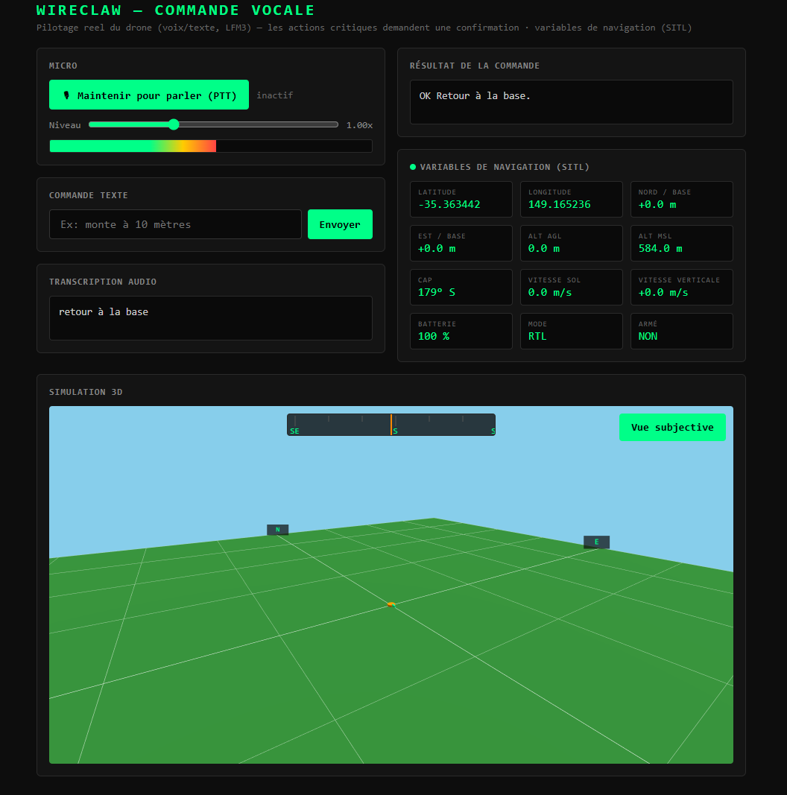

# WireClaw — pilotage de drone en langage naturel

Station sol embarquée (Jetson Orin Nano) pour un drone d'inspection : un
opérateur donne des instructions en français, à l'écrit ou à l'oral, un LLM
local (**LFM3**, via Ollama) les interprète et génère les commandes MAVLink
correspondantes vers ArduPilot.

**Page publique (voix + texte + instruments de navigation + simulation 3D) :**
**[sable.nicolasboyer.com](https://sable.nicolasboyer.com)** — mode d'emploi
sur [sable.nicolasboyer.com/guide.html](https://sable.nicolasboyer.com/guide.html).



## Architecture

```
Opérateur (texte/voix)
        │
        ▼
   wireclaw_core.py ──LFM3 (Ollama local)──► interprétation → commande
        │
        ▼ MAVSDK / pymavlink (UDP)
   MAVProxy ◄──► ArduPilot (SITL aujourd'hui, Matek H743 prévu)
        │
        ▼
  ESP32 (relais WiFi↔UART) ──UART──► liaison radio vers le drone

Pi Zero 2W (caméra) ──H.264/UDP──► receive_cam.py (Jetson)
                                        │
                                        ▼ YOLOv8 (TensorRT)
                                   flux MJPEG annoté (web_server.py)
```

Détail complet des ports réseau, des services systemd, et de l'historique
des choix : [`CLAUDE.md`](CLAUDE.md).

## État réel du projet

- **Vol réel : pas encore.** Le contrôleur de vol est aujourd'hui ArduPilot
  **SITL** (simulé) ; le passage à un vrai contrôleur (Matek H743) fait
  partie des prochaines étapes. Rien ici n'a encore décollé un drone
  physique.
- La réception vidéo Pi Zero → YOLOv8 → MJPEG **fonctionne et a été
  validée**, mais `receive_cam.py` retombe sur un flux synthétique généré
  par numpy quand le Pi Zero n'est pas actif — ne pas confondre les deux
  modes en lisant les logs.
- `MAV_CMD_DO_ORBIT` n'est pas supporté en SITL : la commande `orbit` bascule
  sur un fallback de 16 waypoints circulaires, pas une orbite native.
- La supervision de la batterie est **désactivée** en SITL
  (`BATT_MONITOR=0`) pour éviter les failsafes en simulation — ne pas
  copier cette config telle quelle sur un vol réel.
- Pas de `requirements.txt` : la stack dépend de wheels PyTorch/CUDA
  spécifiques à l'architecture Jetson (Orin, JetPack), pas installables
  depuis PyPI standard. Le détail exact des versions (PyTorch 2.8.0 + CUDA
  12.6, numpy figé à 1.26.4, cv2 système) est documenté dans
  [`CLAUDE.md`](CLAUDE.md) plutôt que figé dans un lockfile qui ne
  reproduirait rien sur une autre machine.
- Caméra thermique (SkyDroid C12) : pas encore intégrée, prévue.
- Il n'y a actuellement **aucune confirmation préalable** avant l'exécution
  d'une commande vocale/texte (retirée volontairement pour accélérer les
  tests) — seules les bornes dures de `validate_command()` (altitude,
  géofence, distances, angles) protègent contre une hallucination du LLM.

## Composants

- `wireclaw_core.py` — cerveau : boucle de commande, interprétation LFM3
  (Ollama local), validation en dur, exécution MAVLink.
- `web_server.py` — API FastAPI (port 8765) qui expose le pilotage, les
  instruments de navigation, et une vue de simulation 3D (`/sim3d`).
- `voice_bridge/` — service FastAPI (port 8766) dédié à la transcription
  audio (LFM3-audio) ; exposé publiquement via nginx sur
  [sable.nicolasboyer.com](https://sable.nicolasboyer.com) (page unique :
  micro/texte, résultat, navigation, simulation 3D, guide).
- `receive_cam.py` — réception H.264 UDP (port 5600) depuis le Pi Zero,
  inférence YOLOv8 (TensorRT), overlay RSSI, sortie MJPEG annotée (port
  5601).
- `config.py` — charge les secrets depuis `.env` (jamais commité).
- `start.sh` — lance le hotspot WiFi du drone, ArduPilot SITL, MAVProxy et
  WireClaw dans l'ordre.
- `config/` — profils radio wifibroadcast (5 GHz / 2,4 GHz), voir
  `scripts/switch_band.sh` pour la bascule.

Projet complémentaire, même écosystème : `wireclaw-pizero`
(côté caméra du drone) et le relais ESP32 (WiFi↔UART).

## Lancer

```bash
cp .env.example .env
# puis éditer .env (mot de passe hotspot WiFi, etc.)
./start.sh
```

Nécessite ArduPilot compilé localement (`~/ardupilot/build/sitl/bin/arducopter`),
MAVProxy, et [Ollama](https://ollama.com) avec les modèles `lfm3` et
`lfm3-audio` installés (`ollama pull lfm3 && ollama pull lfm3-audio`) — voir
[`CLAUDE.md`](CLAUDE.md) pour la stack complète.

## Licence

[MIT](LICENSE).
